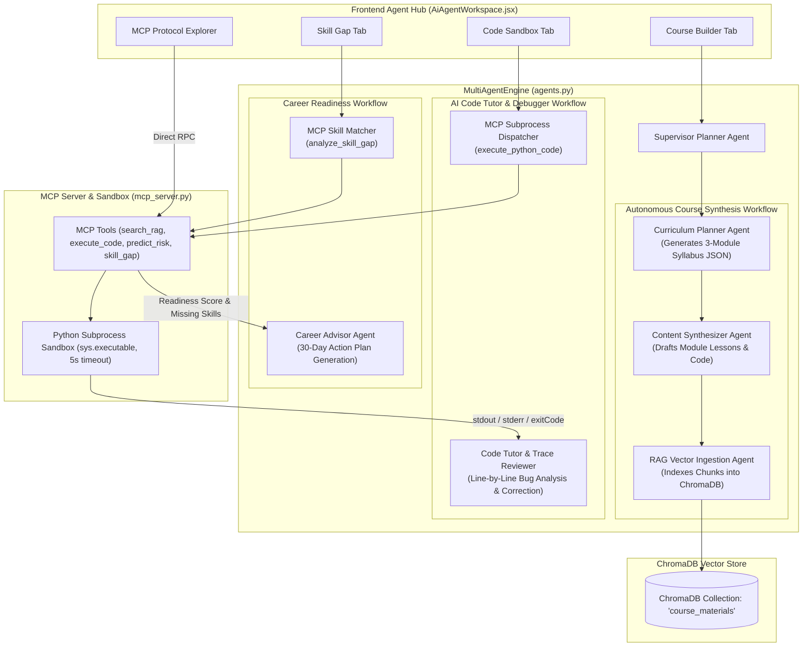
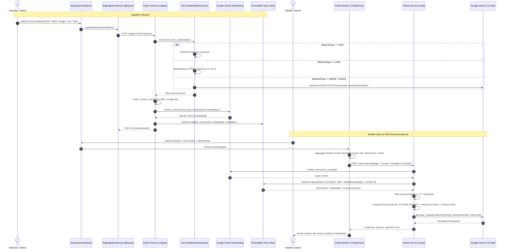

# LearnSphere Platform — AI, Multi-Agent & RAG Technical Deep-Dive

## 1. Overview of AI Ecosystem

LearnSphere incorporates a multi-tiered artificial intelligence framework consisting of:
1. **Multi-Agent Workflow Engine (`python_service/agents.py`)**: Coordinates autonomous agents for curriculum planning, code debugging, and career skill gap matching.
2. **Native Model Context Protocol (MCP) Server (`python_service/mcp_server.py`)**: Exposes standardized JSON-RPC 2.0 tools and platform context resources.
3. **Multi-Modal Retrieval-Augmented Generation (RAG) (`python_service/app.py`)**: Persistent vector store in ChromaDB with `models/gemini-embedding-2` and `gemini-3.6-flash`.
4. **Machine Learning Telemetry Predictor (`python_service/ml_predictor.py`)**: Scikit-Learn `RandomForestClassifier` and `StandardScaler` pipeline assessing student dropout risk and mastery index.
5. **Backend AI Quiz Generator (`LearnSphere-backend/.../AIQuizGeneratorServiceImpl.java`)**: Multi-model Gemini fallback pipeline for rapid exam synthesis.

---

## 2. Multi-Agent System Architecture (`agents.py`)

The multi-agent system utilizes the **Google GenAI SDK** (`google-genai`) paired with structured JSON and tool orchestration to execute autonomous workflows.



### Agent Detailed Breakdown:
1. **Supervisor Planner Agent**: Routes tasks, verifies input schemas, and orchestrates sequential sub-agent handoffs.
2. **Autonomous Course Synthesizer Agent (`run_autonomous_course_builder`)**:
   - **Input**: Topic string (e.g., "Kubernetes Masterclass"), Target Audience (e.g., "Cloud Engineers").
   - **Step 1 (Syllabus Generation)**: Prompts `gemini-3.6-flash` for a strictly validated 3-module syllabus with titles, summaries, and learning objectives.
   - **Step 2 (Content Synthesis)**: Expands each module and lesson with descriptive text and practical examples.
   - **Step 3 (Vector Ingestion)**: Automatically embeds and indexes the synthesized module text directly into ChromaDB for immediate RAG retrieval.
3. **AI Code Tutor & Debugger Agent (`run_code_tutor_agent`)**:
   - **Input**: User-provided Python code snippet, optional student question.
   - **Execution**: Invokes MCP tool `execute_python_code` in an isolated temporary subprocess with a strict 5-second timeout.
   - **LLM Diagnostic**: Feeds `exitCode`, `stdout`, `stderr`, and user code to `gemini-3.6-flash`.
   - **Output**: Returns Execution Status, Step-by-Step Trace Analysis, Corrected Code Solution, and Key Learning Takeaways.
4. **Career & Skill Gap Analyst Agent (`run_career_skill_agent`)**:
   - **Input**: Target Job Role (e.g., "Azentio AI Agent Developer"), User completed courses and quiz history.
   - **Matching**: Invokes MCP tool `analyze_skill_gap` to compare profile against enterprise competency matrices.
   - **Roadmap Synthesis**: Generates an actionable 30-day technical readiness roadmap highlighting project portfolio requirements.

---

## 3. Model Context Protocol (MCP) Server (`mcp_server.py`)

LearnSphere adheres to the standardized **Model Context Protocol (MCP)** specification (JSON-RPC 2.0).

### Registered MCP Tools:
```json
[
  {
    "name": "search_rag_materials",
    "description": "Perform semantic hybrid search across course materials using vector embeddings.",
    "parameters": {
      "type": "object",
      "properties": {
        "query": { "type": "string" },
        "course_id": { "type": "string" },
        "top_k": { "type": "integer" }
      },
      "required": ["query"]
    }
  },
  {
    "name": "execute_python_code",
    "description": "Safely execute Python code snippets in an isolated sandbox environment.",
    "parameters": {
      "type": "object",
      "properties": {
        "code": { "type": "string" },
        "timeout_sec": { "type": "integer" }
      },
      "required": ["code"]
    }
  },
  {
    "name": "predict_student_risk",
    "description": "Run Scikit-Learn ML classifier to calculate student mastery score and dropout risk.",
    "parameters": {
      "type": "object",
      "properties": {
        "avg_quiz_score": { "type": "number" },
        "completion_rate_pct": { "type": "number" },
        "total_time_hours": { "type": "number" },
        "quiz_attempts_avg": { "type": "number" },
        "consecutive_failures": { "type": "integer" }
      },
      "required": ["avg_quiz_score", "completion_rate_pct", "total_time_hours"]
    }
  },
  {
    "name": "analyze_skill_gap",
    "description": "Evaluate student portfolio & progress against target enterprise job descriptions.",
    "parameters": {
      "type": "object",
      "properties": {
        "target_role": { "type": "string" },
        "completed_courses": { "type": "array", "items": { "type": "string" } },
        "quiz_scores": { "type": "object" }
      },
      "required": ["target_role"]
    }
  },
  {
    "name": "generate_adaptive_quiz",
    "description": "Synthesize difficulty-adjusted exam questions using frontier LLM.",
    "parameters": {
      "type": "object",
      "properties": {
        "topic": { "type": "string" },
        "difficulty": { "type": "string", "enum": ["EASY", "MEDIUM", "HARD", "ADAPTIVE"] },
        "num_questions": { "type": "integer" }
      },
      "required": ["topic"]
    }
  }
]
```

### Registered MCP Resources:
- `learnsphere://platform/metrics`: Live vector store counts, ML model states, and RAG status.
- `learnsphere://job-roles/ai-agent-developer`: Required skill matrix for Agentic AI, MCP, Vector DBs, and RAG.

---

## 4. Multi-Modal Retrieval-Augmented Generation (RAG) Pipeline



### Ingestion Details:
- **Chunking Algorithm**: Word-count based windowing with `chunk_size = 500` words and `overlap = 50` words (`app.py:L91-L101`).
- **Embedding Model**: `models/gemini-embedding-2` called via `client.models.embed_content(task_type="RETRIEVAL_DOCUMENT")` for documents and `RETRIEVAL_QUERY` for search queries.
- **Cosine Relevance Threshold**: Retains only chunks where `dist < 0.7` in ChromaDB cosine space, guaranteeing high groundedness and eliminating hallucinations.

---

## 5. Machine Learning Telemetry Predictor (`ml_predictor.py`)

LearnSphere incorporates a Scikit-Learn **RandomForestClassifier** with 50 estimators trained on educational telemetry features.

### Input Features:
1. `avg_quiz_score` (Float, 0 - 100)
2. `completion_rate_pct` (Float, 0 - 100)
3. `total_time_hours` (Float, lifetime learning hours)
4. `quiz_attempts_avg` (Float, average attempts per quiz)
5. `consecutive_failures` (Integer, consecutive failed attempts)

### Mathematical Formulas & Outputs:
$$\text{Mastery Index} = \min\left(100.0, \max\left(0.0, (0.50 \times \text{avg\_quiz\_score}) + (0.35 \times \text{completion\_rate\_pct}) + \left(15.0 \times \min\left(1.0, \frac{\text{total\_time\_hours}}{10.0}\right)\right)\right)\right)$$

- **Risk Tiers**:
  - `0`: **Low Risk (On Track)** — Mastery index high, triggers advanced capstone recommendations.
  - `1`: **Medium Risk (Needs Reinforcement)** — Prompts practice exercises and flashcard reviews.
  - `2`: **High Risk (Intervention Needed)** — Triggers automated AI Mentor proactive outreach and foundational diagnostic quizzes.

---

## 6. Backend AI Quiz Generation with Multi-Model Fallback

In `AIQuizGeneratorServiceImpl.java`, the backend communicates with Google Generative Language API using OkHttp3 with an automatic candidate model fallback chain:
1. `gemini-3.6-flash`
2. `gemini-3-flash-preview`
3. `gemini-3.1-flash-lite`
4. `gemini-3.8-flash`

If a model returns HTTP `429`, `503`, or `404`, the service automatically rotates to the next candidate model in the list, ensuring 99.9% uptime for AI examination generation.
