# LearnSphere Platform — Complete System Architecture Document

## 1. Executive Summary & Architectural Overview

**LearnSphere Platform** is an enterprise-grade, multi-tier, AI-powered adaptive learning and examination system. The platform bridges autonomous Generative AI workflows, real-time Model Context Protocol (MCP) tool execution, hybrid multi-modal Retrieval-Augmented Generation (RAG), and Scikit-Learn machine learning telemetry into a unified pedagogical ecosystem.

The system is structured across three decoupled, resilient architectural tiers:
1. **Frontend Presentation Tier**: Built with React 19, Vite, Redux Toolkit, and Tailwind CSS, delivering responsive dashboards, interactive code execution sandboxes, career skill readiness graphs, and real-time MCP protocol inspection consoles.
2. **Backend Application & Orchestration Tier**: Built with Java 17 and Spring Boot 3.5.7, providing JWT-based role-based access control (RBAC), transactional persistence, business logic execution, asynchronous RAG vector indexing hooks, and proxy routing to AI microservices.
3. **AI Microservice & Agent Tier**: Built with Python 3.11 and Flask, coordinating multi-agent workflows with Google Gemini LLMs, hosting a persistent ChromaDB vector store, running an isolated Python execution sandbox, and executing a Scikit-Learn RandomForest classifier for dropout risk and student mastery predictions.

---

## 2. High-Level System Architecture Diagram

The following diagram illustrates the complete architectural boundaries, inter-service communication protocols, and data stores within the LearnSphere platform:

```mermaid
flowchart TB
    subgraph Client_Layer["Frontend Presentation Tier (Port 5173)"]
        UI_Student["Student Workspace & Dashboard"]
        UI_Instructor["Instructor Studio & Course Management"]
        UI_Admin["Admin Management & Analytics Console"]
        UI_Agent["AI Agent Hub & MCP Protocol Console"]
        UI_Sandbox["Interactive Python Code Sandbox"]
        Redux_Store["Redux Toolkit Global State"]
        Axios_Client["Axios HTTP Client + Auth Interceptors"]
    end

    subgraph Backend_Layer["Backend Service Tier (Spring Boot Port 8080)"]
        Security_Filter["Spring Security 6 (Stateless JWT Filter)"]
        
        subgraph Controllers["REST Controllers"]
            Auth_Ctrl["AuthController"]
            Course_Ctrl["CourseController & TopicController"]
            Mat_Ctrl["MaterialController & ProgressController"]
            Quiz_Ctrl["QuizController & QuizStatisticsController"]
            Cert_Ctrl["CertificateController (iTextPDF + ZXing)"]
            Chat_Ctrl["ChatController"]
            Agent_Proxy_Ctrl["AiAgentController (Proxy)"]
            Analytics_Ctrl["AnalyticsController"]
        end

        subgraph Services["Business Logic Services"]
            Auth_Svc["AuthService & UserDetailsServiceImpl"]
            Course_Svc["CourseService & TopicProgressService"]
            Mat_Svc["MaterialService & CompletionService"]
            Quiz_Svc["QuizAttemptService & AIQuizGeneratorService"]
            Cert_Svc["CertificateService"]
            Chat_Svc["ChatService (Context Aggregator)"]
            Adapt_Svc["AdaptiveLearningService & CourseRecommendationService"]
            RAG_Ingest_Svc["RagIngestionService (@Async)"]
        end

        subgraph Repositories["Data Access Layer (Spring Data JPA)"]
            User_Repo["UserRepository & StudentRepository"]
            Course_Repo["CourseRepository & TopicRepository"]
            Progress_Repo["CourseProgressRepository & TopicProgressRepository"]
            Quiz_Repo["QuizRepository & QuizAttemptRepository"]
            Cert_Repo["CertificateRepository"]
            Activity_Repo["UserActivityRepository & AnalyticsRepository"]
        end
    end

    subgraph Data_Layer["Persistence Layer"]
        H2_DB[("H2 Database (Local Persistent File Mode: ./data/learnspheredb)")]
        Local_FS[("Local File System Storage (/uploads)")]
    end

    subgraph AI_Microservice["AI & Agent Microservice (Python Flask Port 5001)"]
        Flask_App["Flask Web Server + Flask-CORS"]
        
        subgraph Agent_Engine["Multi-Agent Workflow Engine (agents.py)"]
            Supervisor["Supervisor Planner Agent"]
            Course_Builder["Autonomous Course Synthesizer"]
            Code_Tutor["AI Code Tutor & Debugger"]
            Career_Skill["Career Skill Matcher Agent"]
        end

        subgraph MCP_Server["Model Context Protocol Server (mcp_server.py)"]
            MCP_Tools["MCP Tools:\n- search_rag_materials\n- execute_python_code\n- predict_student_risk\n- analyze_skill_gap\n- generate_adaptive_quiz"]
            MCP_Resources["MCP Resources (Platform Metrics, Job Matrices)"]
            Subprocess_Sandbox["Isolated Python Subprocess Sandbox"]
        end

        subgraph ML_Telemetry["Machine Learning Engine (ml_predictor.py)"]
            RF_Model["RandomForestClassifier (Scikit-Learn)"]
            Scaler["StandardScaler Normalizer"]
        end

        subgraph Vector_DB["ChromaDB Vector Store (Persistent Local)"]
            Chroma_Store[("ChromaDB Collection: 'course_materials'\nCosine Similarity Metric")]
        end
    end

    subgraph External_AI_Services["Cloud AI & External Services"]
        Gemini_LLM["Google Gemini 3.6 Flash / 2.5 Flash"]
        Gemini_Embed["Google Gemini Embedding (models/gemini-embedding-2)"]
    end

    %% Communications
    UI_Student --> Axios_Client
    UI_Instructor --> Axios_Client
    UI_Admin --> Axios_Client
    UI_Agent --> Axios_Client
    UI_Sandbox --> Axios_Client
    Axios_Client --> Redux_Store
    Axios_Client -- "REST / JSON (JWT Bearer)" --> Security_Filter

    Security_Filter --> Controllers
    Controllers --> Services
    Services --> Repositories
    Repositories --> H2_DB
    Mat_Svc --> Local_FS

    RAG_Ingest_Svc -- "POST /ingest, /ingest/delete (Async HTTP)" --> Flask_App
    Chat_Ctrl -- "POST /chat (Aggregated Context + Attachment Payload)" --> Flask_App
    Agent_Proxy_Ctrl -- "POST /api/agents/*, /api/ml/*" --> Flask_App

    Flask_App --> Agent_Engine
    Flask_App --> MCP_Server
    Flask_App --> ML_Telemetry
    Flask_App --> Vector_DB

    MCP_Server --> Subprocess_Sandbox
    Agent_Engine --> MCP_Server
    MCP_Server --> Vector_DB

    Flask_App -- "Embed Content API" --> Gemini_Embed
    Flask_App -- "Generate Content API" --> Gemini_LLM
    Quiz_Svc -- "Direct Gemini API (Fallback / GenerateContent)" --> Gemini_LLM
```

---

## 3. Tier-by-Tier Architectural Decomposition

### Tier 1: Frontend Presentation Layer (React 19 + Vite)
- **Routing & Navigation**: `react-router-dom` v7 manages client-side routing with granular authentication guards (`PrivateRoute.jsx`) enforcing role boundaries (`STUDENT`, `INSTRUCTOR`, `ADMIN`).
- **State Management**: Redux Toolkit (`@reduxjs/toolkit` + `react-redux`) maintains global authentication status, active user tokens, and user profile data.
- **HTTP Interception**: Axios client configured in `src/services/api.js` attaches JWT Bearer tokens to outbound requests and handles automatic 401 token refresh queueing via `/api/auth/refresh`.
- **UI & Animations**: Tailwind CSS v4 provides atomic utility styling, complemented by `lucide-react`, `framer-motion`, `gsap`, and `recharts` for rich telemetry charts.

### Tier 2: Backend Application & Security Layer (Spring Boot 3.5.7)
- **Security & Authorization**: Spring Security 6 operates in a stateless mode. `JwtAuthenticationFilter` intercepts requests, parses standard Claims, and populates Spring's `SecurityContextHolder`. Method-level `@EnableMethodSecurity` and HTTP URL matchers in `SecurityConfig.java` strictly authorize access.
- **Persistence & ORM**: Spring Data JPA with Hibernate manages database transactions. Persistent H2 database operates with `AUTO_SERVER=TRUE` in `./data/learnspheredb`.
- **Document Generation**: `CertificateService.java` dynamically generates tamper-evident vector PDF certificates using iTextPDF 5.5 and generates cryptographically verifiable verification QR codes via ZXing.
- **Asynchronous Orchestration**: `RagIngestionService.java` uses `@Async` non-blocking Spring tasks to dispatch multi-modal course materials to the Python microservice for immediate vector embedding and indexing.

### Tier 3: Python AI & Multi-Agent Microservice (Flask + ChromaDB + Gemini)
- **Multi-Agent Engine (`agents.py`)**: Defines autonomous multi-step agent execution routines (`SupervisorAgent`, `CourseCreatorAgent`, `CodeTutorAgent`, `CareerSkillAgent`).
- **MCP Server (`mcp_server.py`)**: Implements JSON-RPC 2.0 compliant Model Context Protocol tools and platform context resources.
- **Persistent Vector Database**: ChromaDB runs locally (`./chroma_db`) with persistent collections configured with Cosine similarity space (`hnsw:space: cosine`).
- **Machine Learning Telemetry (`ml_predictor.py`)**: Houses a Scikit-Learn `RandomForestClassifier` and `StandardScaler` pipeline assessing student completion velocities, attempt counts, and failures to classify risk and predict mastery indices.

---

## 4. Component Responsibility Matrix

| Component / Layer | Primary Responsibility | Data Input | Data Output |
| :--- | :--- | :--- | :--- |
| **`React UI Components`** | User interaction, visualization, and client-side validation | User inputs, mouse/keyboard events, Redux state | Rendered DOM, Axios HTTP requests |
| **`JwtAuthenticationFilter`** | Token verification, user identity extraction, security context initialization | HTTP Authorization Header (`Bearer <JWT>`) | `UsernamePasswordAuthenticationToken` |
| **`AuthController` / `AuthService`** | User registration, login, token refresh, password reset | `AuthRequest`, `RegisterRequest` | `AuthResponse` (JWT, Refresh Token, UserDTO) |
| **`CourseService` / `TopicService`** | Course lifecycle, curriculum structure, module ordering | Course DTOs, Instructor credentials | Course entities, Topic hierarchies |
| **`MaterialService`** | Multi-modal asset management (Text, PDF, Video, Image, Link) | Multipart file payloads, URLs, Text | Persisted `Material`, triggers `@Async` RAG ingestion |
| **`QuizAttemptService`** | Evaluates student exam submissions, records scores, awards gamification points | `AnswerSubmission` list, Quiz ID, Student ID | `QuizAttempt` entity, updated Progress & Points |
| **`AdaptiveLearningService`** | Analyzes prior quiz scores to recommend next topic (Revision/Practice/Next) | Student ID, Course ID, Topic Quiz history | `TopicRecommendationResponse` |
| **`CourseRecommendationService`** | Recommends next courses based on level progression, category, and skills | Student ID, Completed Course ID, User Profile | Filtered & ranked `List<Course>` |
| **`AnalyticsService`** | Aggregates student, instructor, and platform-wide telemetry metrics | DB queries via Spring Data JPA repositories | `AnalyticsDTO` (Pie, Bar, Line chart structures) |
| **`CertificateService`** | Verifies 100% course completion, renders signed PDF certificate with QR code | Student ID, Course ID, Verification UID | Binary PDF byte array, QR code image |
| **`RagIngestionService`** | Asynchronously transfers material payloads to Python vector ingestor | `Material` entity | HTTP POST to `http://localhost:5001/ingest` |
| **`ChatService`** | Builds student pedagogical context and dispatches RAG chat requests | Student Email, `ChatRequest`, Multipart files | `ChatResponse` with AI text and source citations |
| **`AiAgentController`** | HTTP Gateway proxying agent requests to Python microservice | JSON payloads from frontend agent hub | Proxied JSON responses from Python service |
| **`python_service/app.py`** | Flask microservice hosting RAG ingestion, RAG chat, and agent endpoints | Ingestion payloads, Student queries, Agent tasks | ChromaDB vector writes, Gemini LLM outputs |
| **`agents.py`** | Multi-agent state coordination (Course Builder, Code Tutor, Skill Matcher) | Topic strings, Code snippets, Student profiles | Multi-step agent execution JSON & text traces |
| **`mcp_server.py`** | Exposes standardized MCP tool schemas, resource schemas, and safe execution | MCP tool invocation requests | Tool execution outputs & error diagnostics |
| **`ml_predictor.py`** | Scikit-Learn RandomForest classifier evaluating dropout risk & mastery index | 5-dimensional student performance feature vectors | Composite Mastery Score, Risk Tier, Probabilities |

---

## 5. Network Architecture & Communication Protocols

| Source | Destination | Protocol | Port / Endpoint | Payload Format | Authentication |
| :--- | :--- | :--- | :--- | :--- | :--- |
| **Browser** | **Frontend (Vite Dev)** | HTTP / WS (HMR) | `http://localhost:5173` | HTML / JS / CSS Assets | None (Public) |
| **Frontend** | **Backend (Spring Boot)** | HTTPS / HTTP REST | `http://localhost:8080/api/*` | JSON / Multipart Form | JWT Bearer Token |
| **Backend** | **Python AI Service** | HTTP REST | `http://localhost:5001/*` | JSON / Multipart Form | Internal Microservice Call |
| **Backend** | **H2 Database Engine** | JDBC | `jdbc:h2:file:./data/learnspheredb` | SQL Transactions | Database Credentials (`sa`) |
| **Python Service** | **Google Gemini API** | HTTPS REST / gRPC | `https://generativelanguage.googleapis.com` | JSON / Proto RPC | Google Gemini API Key |
| **Backend** | **Google Gemini API** | HTTPS REST | `https://generativelanguage.googleapis.com` | JSON (OkHttp3 client) | Google Gemini API Key |
