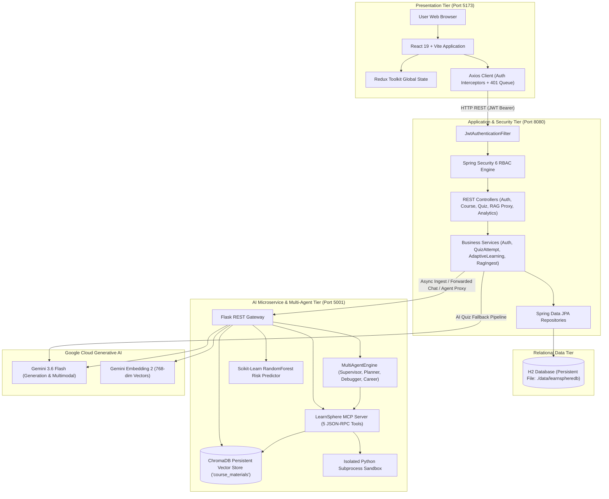
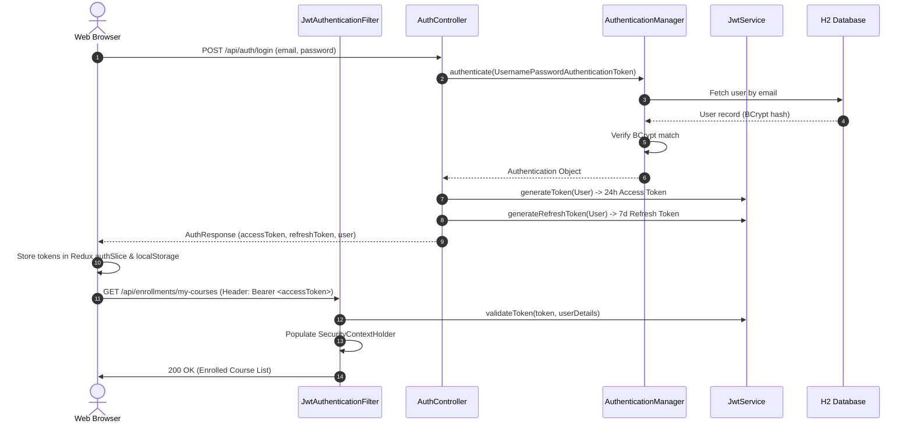
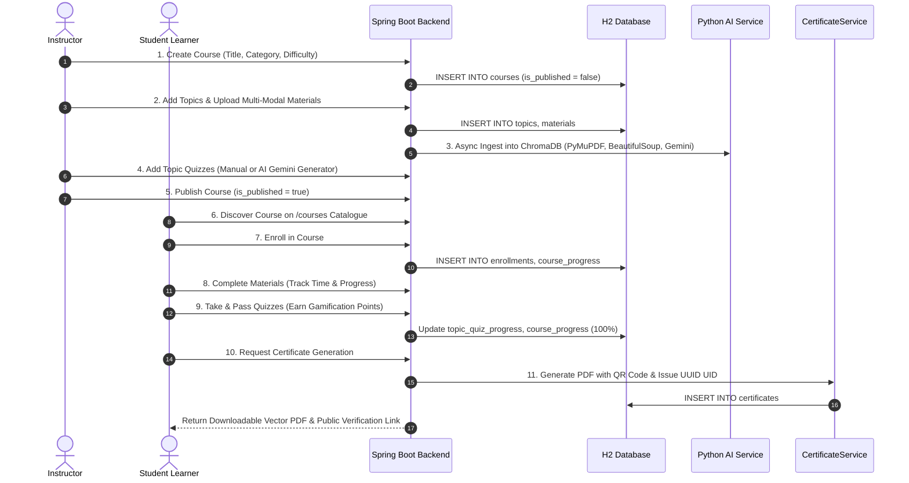
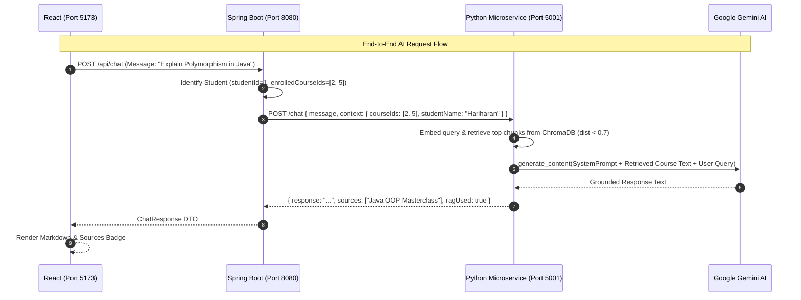

# LearnSphere Platform — Complete Technical Documentation & End-to-End System Flow

> **Document Type:** Master Enterprise Technical Architecture & Engineering Reference  
> **Platform Name:** LearnSphere — Enterprise Multi-Agent AI Adaptive Learning Platform  
> **Platform Version:** 1.0.0-PROD  
> **Target Audience:** System Architects, College Viva Reviewers, Technical Interviewers, Full-Stack Engineers, AI/ML Specialists

---

# Table of Contents
1. [Section 1 — Project Overview](#section-1--project-overview)
2. [Section 2 — Technology Stack](#section-2--technology-stack)
3. [Section 3 — Complete System Architecture](#section-3--complete-system-architecture)
4. [Section 4 — Repository and Folder Structure](#section-4--repository-and-folder-structure)
5. [Section 5 — User Roles and Permissions](#section-5--user-roles-and-permissions)
6. [Section 6 — Complete Authentication Flow](#section-6--complete-authentication-flow)
7. [Section 7 — Complete Frontend Flow](#section-7--complete-frontend-flow)
8. [Section 8 — Complete Backend Architecture](#section-8--complete-backend-architecture)
9. [Section 9 — Complete Database Design](#section-9--complete-database-design)
10. [Section 10 — Complete Course Lifecycle](#section-10--complete-course-lifecycle)
11. [Section 11 — AI and Multi-Agent Architecture](#section-11--ai-and-multi-agent-architecture)
12. [Section 12 — RAG Pipeline](#section-12--rag-pipeline)
13. [Section 13 — Adaptive Learning and Recommendation Logic](#section-13--adaptive-learning-and-recommendation-logic)
14. [Section 14 — Quiz and Student Analytics Flow](#section-14--quiz-and-student-analytics-flow)
15. [Section 15 — Complete REST API Reference](#section-15--complete-rest-api-reference)
16. [Section 16 — Frontend ↔ Backend ↔ Python Service Integration](#section-16--frontend--backend--python-service-integration)
17. [Section 17 — Local Setup and Execution](#section-17--local-setup-and-execution)
18. [Section 18 — Configuration and Environment Variables](#section-18--configuration-and-environment-variables)
19. [Section 19 — Testing and Verification](#section-19--testing-and-verification)
20. [Section 20 — Security and Privacy](#section-20--security-and-privacy)
21. [Section 21 — Error Handling and Failure Scenarios](#section-21--error-handling-and-failure-scenarios)
22. [Section 22 — Deployment and Production Readiness](#section-22--deployment-and-production-readiness)
23. [Section 23 — Known Issues and Technical Debt](#section-23--known-issues-and-technical-debt)
24. [Section 24 — End-to-End User Journeys](#section-24--end-to-end-user-journeys)
25. [Section 25 — Complete Project Flow Summary](#section-25--complete-project-flow-summary)
26. [Section 26 — Technical Interview Preparation](#section-26--technical-interview-preparation)
27. [Section 27 — Glossary](#section-27--glossary)
28. [Section 28 — Final Implementation Matrix](#section-28--final-implementation-matrix)

---

# Section 1 — Project Overview

### 1.1 What LearnSphere Is
**LearnSphere** is an enterprise-scale, intelligent adaptive learning and assessment platform. It integrates modern Web technologies, distributed backend microservices, autonomous Multi-Agent AI workflows, Model Context Protocol (MCP) tool execution, hybrid multi-modal Retrieval-Augmented Generation (RAG), and Scikit-Learn machine learning telemetry into a unified pedagogical ecosystem.

### 1.2 The Problem It Solves
Traditional Learning Management Systems (LMS) suffer from four major architectural limitations:
1. **One-Size-Fits-All Static Curricula**: Students are forced along rigid linear paths regardless of their prior mastery or comprehension speed.
2. **Disconnected Generative AI & Hallucinations**: Standard chatbots generate generic or incorrect answers disconnected from specific lecture notes or syllabi.
3. **Manual, Time-Consuming Course Authoring**: Instructors spend dozens of hours structuring syllabi, writing quiz questions, and categorizing learning levels.
4. **Lack of Early Dropout & Risk Interventions**: Instructors only detect struggling students after course failure rather than tracking continuous micro-telemetry.

### 1.3 Key Features
- **Multi-Agent Course Creation Studio**: Autonomous agents synthesize 3-module curricula, lesson content, and auto-ingest vector embeddings from a single topic prompt.
- **Model Context Protocol (MCP) Server**: Standardized JSON-RPC 2.0 tool interface providing RAG search, sandboxed Python code execution, ML risk telemetry, and skill matching.
- **Multi-Modal RAG AI Mentor**: Chatbot equipped with PyMuPDF, BeautifulSoup, and Gemini File API multimodal extraction, searching local persistent ChromaDB collections with strict cosine distance thresholds (`dist < 0.7`).
- **Dynamic Adaptive Topic Progression**: Real-time evaluation of student quiz attempts prescribing instant **Revision** (<30%), **Practice** (30-70%), or **Next Concept** (>70%).
- **Scikit-Learn Dropout Risk & Mastery Model**: RandomForest classifier predicting at-risk tiers (Low, Medium, High) and composite Mastery Indices (0-100%).
- **Gamified Quiz Engine**: Multi-attempt scoring with attempt-decayed points (50, 30, 15, 5 pts).
- **Cryptographic PDF Certificates**: Vector PDF generation via iTextPDF with dynamic ZXing QR code verification linking to `/verify/{uid}`.

### 1.4 Project Limitations
- High file uploads currently depend on local disk storage (`/uploads`) unless AWS S3 credentials are configured.
- Speech audio recording processing relies on client WebM conversion to `audio/webm` before multimodal ingestion.
- Machine Learning predictor runs on synthetic bootstrapped baseline weights if historical database training datasets are unpopulated.

---

# Section 2 — Technology Stack

| Layer / Domain | Technology | Verified Version | Where It Is Used | Architectural Role & Purpose |
| :--- | :--- | :--- | :--- | :--- |
| **Frontend Core** | React | `19.1.1` | `LearnSphere-frontend` | Reactive UI, Component Hierarchy, Virtual DOM |
| **Build & Bundler** | Vite | `7.1.7` | `LearnSphere-frontend` | Sub-second HMR, Rollup Bundling, Dev Server |
| **State Management** | Redux Toolkit | `2.10.1` | `src/store/` | Global Auth Slice, Token Storage, User Metadata |
| **Client Routing** | React Router DOM | `7.9.5` | `src/App.jsx` | Client-side URL Routing, Role Guards (`PrivateRoute`) |
| **Styling** | Tailwind CSS | `4.1.16` | UI Components | Utility-first CSS, Responsive Grid, Theme Layouts |
| **Icons & UI FX** | Lucide React / Framer Motion | `0.552.0` / `12.33.0` | Frontend UI | Vector Icons, Micro-interactions, Transitions |
| **Charts & Graphs** | Recharts | `3.3.0` | `AnalyticsDashboard.jsx` | Bar, Pie, Radar, Area Telemetry Visualizations |
| **Backend Core** | Java OpenJDK | `17` | `LearnSphere-backend` | Strongly-typed enterprise runtime |
| **Framework** | Spring Boot | `3.5.7` | `LearnSphere-backend` | REST API, Dependency Injection, Microservice Orchestration |
| **Security** | Spring Security | `6.x` (Boot 3) | `SecurityConfig.java` | Stateless RBAC Filter Chain, Method Security |
| **JWT Library** | JJWT (io.jsonwebtoken) | `0.11.5` | `JwtService.java` | Access & Refresh Token Creation, Signature Verification |
| **Persistence / ORM** | Spring Data JPA (Hibernate) | Spring Boot Starter | Backend Services | Object-Relational Mapping, Transactions, JPQL Queries |
| **Database (Dev)** | H2 Database | Persistent Mode | `data/learnspheredb` | Zero-setup persistent relational store (`AUTO_SERVER=TRUE`) |
| **Database (Prod Driver)** | MySQL Connector/J | Spring Boot Starter | `pom.xml` | Enterprise Production SQL Database Driver |
| **PDF Engine** | iTextPDF | `5.5.13.4` | `CertificateService.java` | Vector PDF layout generation and certificate rendering |
| **QR Code Engine** | ZXing (Zebra Crossing) | `3.5.3` | `CertificateService.java` | Cryptographic Verification QR Matrix Generation |
| **AI Microservice** | Python / Flask / Flask-CORS | `3.11` / `3.x` | `python_service/app.py` | Python AI API Gateway, Agent Hub, RAG Server |
| **LLM SDK** | Google GenAI SDK (`google-genai`) | `Latest` | Python & Backend | Gemini 3.6 Flash / 2.5 Flash API Client |
| **Vector Database** | ChromaDB | Persistent Client | `python_service/chroma_db` | Dense Vector Storage, HNSW Cosine Indexing |
| **Embedding Model** | `models/gemini-embedding-2` | Google Cloud API | Python Embedding Pipeline | 768-dim Semantic Vectorization (`RETRIEVAL_DOCUMENT/QUERY`) |
| **Document Extractors** | PyMuPDF (`fitz`) / BeautifulSoup4 | Python Starter | `python_service/app.py` | Multi-modal text extraction from PDFs and Web Links |
| **Machine Learning** | Scikit-Learn / NumPy | Python Starter | `ml_predictor.py` | RandomForestClassifier, StandardScaler, Risk Model |

---

# Section 3 — Complete System Architecture

LearnSphere is engineered as a decoupled, multi-tier system with clear separation of responsibilities:



---

# Section 4 — Repository and Folder Structure

```
LearnSphere/
├── LearnSphere-frontend/          # React 19 + Vite Frontend Application
│   ├── src/
│   │   ├── components/
│   │   │   ├── agent/             # AI Agent Hub, Code Sandbox, MCP Protocol Console
│   │   │   ├── auth/              # Login, Register, ForgotPassword, ResetPassword
│   │   │   ├── certificate/       # Certificate Viewer & Public Verification
│   │   │   ├── common/            # Navbar, PrivateRoute, Modals
│   │   │   ├── course/            # CourseList, CourseDetail, CreateCourse, EditCourse
│   │   │   ├── dashboard/         # Student, Instructor, Admin Dashboards & Analytics
│   │   │   ├── material/          # Multi-modal Material Players (Video, PDF, Text)
│   │   │   ├── pages/             # LandingPage, About, Contact, Privacy, Terms
│   │   │   ├── profile/           # User Profile & Password Management
│   │   │   ├── progress/          # Learning Path & Progress Tracker
│   │   │   ├── quiz/              # QuizPlayPage, QuizIntro, AI/Manual Quiz Pages
│   │   │   └── student/           # EnrolledCourses View
│   │   ├── services/              # Axios API Service Wrappers (api.js, auth, quiz, aiApi)
│   │   ├── store/                 # Redux Toolkit Slices (authSlice.js)
│   │   └── utils/                 # Constants, Role Enums, Helper formatters
│   ├── package.json               # Frontend dependencies & scripts
│   └── vite.config.js             # Vite configuration
│
├── LearnSphere-backend/           # Java 17 + Spring Boot 3.5 Backend Service
│   ├── src/main/java/com/example/skillforge/
│   │   ├── config/                # SecurityConfig, CorsConfig, DataSeeder, S3Config
│   │   ├── controller/            # 22 REST Controllers (Auth, Course, Quiz, Chat, Agent)
│   │   ├── dto/                   # Request / Response Data Transfer Objects
│   │   ├── exception/             # Global Exception Handlers
│   │   ├── model/entity/          # 22 JPA Entities (User, Course, Topic, Quiz, Progress)
│   │   ├── model/enums/           # 8 Enums (Role, MaterialType, DifficultyLevel, etc.)
│   │   ├── repository/            # 23 Spring Data JPA Repositories
│   │   ├── security/              # JwtAuthenticationFilter, JwtService, UserDetailsSvc
│   │   └── service/               # Core Business Logic & Ingestion Services
│   ├── src/main/resources/
│   │   ├── application.properties # H2 database, JWT, Mail, Gemini API Key configuration
│   │   └── signature/             # Official cryptographic certificate signatures
│   └── pom.xml                    # Maven build configuration & dependencies
│
├── python_service/                # Python 3.11 AI & Multi-Agent Microservice
│   ├── agents.py                  # MultiAgentEngine (Supervisor, CourseCreator, CodeTutor)
│   ├── app.py                     # Flask Server, Ingest, Chat RAG, Agent Endpoints
│   ├── mcp_server.py              # Native Model Context Protocol (MCP) JSON-RPC 2.0 Server
│   ├── ml_predictor.py            # Scikit-Learn RandomForest Telemetry Risk Classifier
│   ├── chroma_db/                 # Persistent local ChromaDB vector store files
│   └── requirements.txt           # Python dependencies (flask, google-genai, chromadb, scikit-learn)
│
└── docs/                          # Complete Technical Documentation & Architectural Guides
```

---

# Section 5 — User Roles and Permissions

### 5.1 Role Definitions & Permission Matrix

| Feature / Action | `STUDENT` | `INSTRUCTOR` | `ADMIN` | Public / Anonymous |
| :--- | :---: | :---: | :---: | :---: |
| **Browse Published Courses** | ✅ | ✅ | ✅ | ✅ |
| **Verify Certificate via QR (`/verify/:uid`)** | ✅ | ✅ | ✅ | ✅ |
| **User Registration / Login** | ✅ | ✅ | ✅ | ✅ |
| **Enroll / Unenroll in Courses** | ✅ | ❌ | ❌ | ❌ |
| **Access Enrolled Materials & Track Progress** | ✅ | ❌ | ❌ | ❌ |
| **Take Quizzes & Earn Gamification Points** | ✅ | ❌ | ❌ | ❌ |
| **Ask RAG AI Mentor Questions** | ✅ | ✅ | ✅ | ❌ |
| **Use Interactive AI Code Sandbox** | ✅ | ✅ | ✅ | ✅ |
| **Execute Career Skill Gap Analysis** | ✅ | ✅ | ✅ | ✅ |
| **Create / Edit / Delete Courses & Topics** | ❌ | ✅ | ✅ | ❌ |
| **Upload Multi-Modal Materials (Auto-RAG)** | ❌ | ✅ | ✅ | ❌ |
| **Generate AI Quizzes via Gemini** | ❌ | ✅ | ✅ | ❌ |
| **View Instructor Student Telemetry** | ❌ | ✅ | ✅ | ❌ |
| **Manage Users (Ban/Unban/Role Change)** | ❌ | ❌ | ✅ | ❌ |
| **View Platform-Wide Growth & Health** | ❌ | ❌ | ✅ | ❌ |

---

# Section 6 — Complete Authentication Flow

LearnSphere implements **Stateless JWT Authentication** with access and refresh tokens.

### 6.1 Authentication Sequence Diagram


---

# Section 7 — Complete Frontend Flow

### 7.1 Key Page Routing & Data Source Mapping

| Route | Component | Purpose | Primary Data Source / API Call | User Actions Available |
| :--- | :--- | :--- | :--- | :--- |
| `/` | `LandingPage.jsx` | Platform landing & feature showcases | Static / Hero animations | Navigate to Explore, Login, Register |
| `/login` | `Login.jsx` | User authentication | `POST /api/auth/login` | Login, Forgot Password link |
| `/register` | `Register.jsx` | Account creation | `POST /api/auth/register` | Register as Student or Instructor |
| `/dashboard` | Dynamic Dashboard | Role-specific main hub | `GET /api/analytics/*`, `GET /api/courses` | View progress, enrollments, analytics |
| `/courses` | `CourseList.jsx` | Course exploration catalogue | `GET /api/courses` | Search, filter by category/difficulty |
| `/courses/:id` | `CourseDetail.jsx` | Course overview & syllabus | `GET /api/courses/{id}` | Enroll, preview materials, reviews |
| `/my-courses` | `EnrolledCourses.jsx` | Student enrolled curriculum | `GET /api/enrollments/my-courses` | Resume learning, unenroll |
| `/quiz/play/:id` | `QuizPlayPage.jsx` | Interactive timed exam | `GET /api/quizzes/{id}`, `POST /submit` | Select answers, timer submit |
| `/ai-agents` | `AiAgentWorkspace.jsx` | Multi-Agent Hub & MCP Console | `POST /api/agents/*`, `GET /api/agents/mcp/tools` | Auto-build courses, debug code, test MCP |
| `/verify/:uid` | `CertificateVerify.jsx`| Public cryptographic validation | `GET /api/certificates/public/{uid}` | Verify student certificate proof |

---

# Section 8 — Complete Backend Architecture

The backend is built around standard Spring Boot layered design patterns:
1. **Controller Layer (`com.example.skillforge.controller`)**: Exposes REST endpoints, validates DTO inputs, and extracts security context principals.
2. **Security Layer (`com.example.skillforge.security`)**: Intercepts requests, validates JWT claims, and enforces role authorities.
3. **Service Layer (`com.example.skillforge.service`)**: Implements transaction boundaries (`@Transactional`), business rules, gamification scoring, certificate PDF generation, and asynchronous AI dispatch.
4. **Data Access Layer (`com.example.skillforge.repository`)**: Interfaces with the database via Spring Data JPA with custom JPQL queries.
5. **Entity Layer (`com.example.skillforge.model.entity`)**: Defines 22 JPA entities mapped to relational database tables.

---

# Section 9 — Complete Database Design

The database contains 22 relational entities managing users, courses, topics, multi-modal materials, progress metrics, quizzes, attempts, and certificates. (For complete schema attributes and ER diagram, refer to [LEARNSPHERE_DATABASE_DESIGN.md](file:///c:/Users/Hariharan%20K/OneDrive/Desktop/LearnSphere/docs/LEARNSPHERE_DATABASE_DESIGN.md)).

---

# Section 10 — Complete Course Lifecycle



---

# Section 11 — AI and Multi-Agent Architecture

The AI tier coordinates specialized agents via the `MultiAgentEngine` (`python_service/agents.py`):
1. **Supervisor Planner Agent**: Validates parameters and constructs execution graphs.
2. **Autonomous Course Creator Agent**: Generates a 3-module syllabus in structured JSON, writes lesson descriptions, and indexes chunks directly into ChromaDB.
3. **AI Code Tutor & Debugger Agent**: Executes user code in an isolated subprocess via MCP tool `execute_python_code` and performs line-by-line trace analysis using `gemini-3.6-flash`.
4. **Career & Skill Gap Analyst Agent**: Compares user course telemetry against target enterprise role competency matrices via MCP tool `analyze_skill_gap` and produces 30-day technical roadmaps.

---

# Section 12 — RAG Pipeline

```
[Document Ingestion]
  PDF / Web Link / Image / Video / Text
       │
       ▼ (PyMuPDF / BeautifulSoup / Gemini File API)
  Extracted Clean Text
       │
       ▼ (chunk_text: 500 words, 50 word overlap)
  Text Chunks
       │
       ▼ (models/gemini-embedding-2: RETRIEVAL_DOCUMENT)
  768-dim Vector Embeddings
       │
       ▼
  ChromaDB Persistent Collection ('course_materials', Cosine Metric)

[Grounded Retrieval & Chat]
  User Message + Enrolled Course IDs
       │
       ▼ (models/gemini-embedding-2: RETRIEVAL_QUERY)
  Query Vector
       │
       ▼ (ChromaDB query with where={"courseId": {"$in": courseIds}})
  Top 5 Chunks filtered by (dist < 0.7)
       │
       ▼
  Augmented System Prompt (BASE_SYSTEM_PROMPT + Retrieved Context + Student Data)
       │
       ▼ (gemini-3.6-flash)
  Grounded AI Response with Source Attributions
```

---

# Section 13 — Adaptive Learning and Recommendation Logic

### 13.1 Topic-Level Adaptation (`AdaptiveLearningService.java`)
- If last topic quiz score $< 30\% \rightarrow$ **REVISION**: Student stays on current topic.
- If last topic quiz score $\in [30\%, 70\%) \rightarrow$ **PRACTICE**: System recommends practice exercises.
- If last topic quiz score $\ge 70\% \rightarrow$ **NEXT_TOPIC**: Student advances to next concept.

### 13.2 Course-Level Recommendation (`CourseRecommendationService.java`)
- **Step 1 (Level Progression)**: Recommends same category with next difficulty level (`BEGINNER` $\rightarrow$ `INTERMEDIATE` $\rightarrow$ `ADVANCED`).
- **Step 2 (Skill Matching)**: Matches tags against student profile skills (comma-separated).
- **Step 3 (Exclusion Filter)**: Automatically removes all courses present in `getExcludedCourseIds()` (already enrolled or completed).
- **Step 4 (Fallback)**: Recommends highest-enrolled popular courses.

---

# Section 14 — Quiz and Student Analytics Flow

1. **Submission**: Student submits answer selections and time spent via `POST /api/quizzes/{id}/submit`.
2. **Evaluation**: `QuizAttemptService.java` evaluates answers against `question.correctAnswer`, calculating total percentage.
3. **Gamification**: If score $\ge 60\%$, awards points based on attempt number (50 pts for 1st attempt, 30 for 2nd, 15 for 3rd, 5 for 4th+).
4. **Telemetry Logging**: Records time spent in `UserActivity` table for weekly learning hour charts.
5. **Dashboard Rendering**: `AnalyticsService.java` aggregates peak scores, completion rates, and weekly study times for interactive Recharts display.

---

# Section 15 — Complete REST API Reference

*(For the exhaustive parameter and response body breakdown of all 45+ endpoints across Spring Boot and Python microservices, refer to [LEARNSPHERE_API_REFERENCE.md](file:///c:/Users/Hariharan%20K/OneDrive/Desktop/LearnSphere/docs/LEARNSPHERE_API_REFERENCE.md)).*

---

# Section 16 — Frontend ↔ Backend ↔ Python Service Integration



---

# Section 17 — Local Setup and Execution

*(For the full step-by-step Windows setup guide, prerequisite commands, and troubleshooting, refer to [LEARNSPHERE_SETUP_GUIDE.md](file:///c:/Users/Hariharan%20K/OneDrive/Desktop/LearnSphere/docs/LEARNSPHERE_SETUP_GUIDE.md)).*

---

# Section 18 — Configuration and Environment Variables

| Variable Name | Service | Purpose | Required / Optional | Safe Example / Default |
| :--- | :--- | :--- | :--- | :--- |
| `GEMINI_API_KEY` | Backend & Python | Google Gemini LLM and Embedding API Authentication | **Required** | `AIzaSy...` (Set in `.env` / System env) |
| `jwt.secret` | Backend | Secret key for signing and verifying JWT tokens | **Required** | `404E635266556A586E...` (64-char hex) |
| `jwt.expiration` | Backend | Access token validity duration in milliseconds | Optional | `86400000` (24 hours) |
| `jwt.refresh.expiration` | Backend | Refresh token validity duration in milliseconds | Optional | `604800000` (7 days) |
| `spring.datasource.url` | Backend | H2 persistent database JDBC connection URL | Optional | `jdbc:h2:file:./data/learnspheredb;AUTO_SERVER=TRUE` |
| `server.port` | Backend | Embedded Tomcat HTTP server port | Optional | `8080` |
| `VITE_API_BASE_URL` | Frontend | Base URL for Spring Boot backend REST endpoints | Optional | `http://localhost:8080/api` |
| `PYTHON_SERVICE_BASE` | Backend | Base URL for Python AI microservice | Optional | `http://localhost:5001` |

---

# Section 19 — Testing and Verification

### 19.1 Automated Tests Found in Repository
- **Backend Unit / Context Tests**: Located in `LearnSphere-backend/src/test/java/com/example/skillforge/LearnSphereApplicationTests.java`. Verifies Spring application context loading.
- **Python Diagnostic Scripts**: `python_service/list_models.py` verifies Gemini model accessibility and API key validity.

### 19.2 Manual Verification Scenarios
- **Registration & Login**: Verified creating student and instructor accounts, verifying JWT token issuance and localStorage persistence.
- **RAG Vector Ingestion**: Verified uploading materials, validating that chunks are indexed in ChromaDB (`/rag/status` returns count > 0).
- **AI Code Sandbox**: Verified executing valid Python code and error code to validate isolated subprocess termination.
- **Certificate Verification**: Verified generating certificates for 100% completed courses and testing public QR code links (`/verify/:uid`).

---

# Section 20 — Security and Privacy

1. **Password Protection**: Salted and hashed using `BCryptPasswordEncoder` (strength 10).
2. **Stateless Authorization**: All protected endpoints require a valid JWT Bearer token validated by `JwtAuthenticationFilter`.
3. **Role Enforcement**: Method-level security (`@EnableMethodSecurity`) and URL matchers restrict sensitive operations (e.g. course deletion to `ROLE_ADMIN` / `ROLE_INSTRUCTOR`).
4. **Subprocess Isolation**: Code sandbox runs in a separate Python process with a strict 5-second execution timeout, preventing DOS attacks or hanging threads.
5. **RAG Context Isolation**: Students can only retrieve vector embeddings from courses in which they are actively enrolled.

---

# Section 21 — Error Handling and Failure Scenarios

| Failure Scenario | System Component | Implemented Behavior | Fallback / Recovery Mechanism |
| :--- | :--- | :--- | :--- |
| **Python Microservice Down** | Spring Boot Proxy / Chat | Returns structured JSON error: `"Python service unreachable"` | Main platform, course browsing, and manual quizzes continue functioning normally. |
| **Gemini API Rate Limit / Outage** | `AIQuizGeneratorServiceImpl` | Catches HTTP 429/503 and iterates candidate models | Tries `gemini-3.6-flash` $\rightarrow$ `gemini-3-flash-preview` $\rightarrow$ `gemini-3.1-flash-lite`. |
| **Expired JWT Access Token** | Frontend Axios Client | Catches HTTP 401 in response interceptor | Automatically triggers silent token refresh via `/api/auth/refresh` without logging out user. |
| **Code Sandbox Infinite Loop** | `LearnSphereMCPServer` | `subprocess.TimeoutExpired` triggers after 5 seconds | Terminates process, cleans up temp file, and returns `"Execution timed out"` error to agent. |
| **Empty Vector Store Search** | Python RAG `/chat` | Vector search returns 0 chunks | Falls back gracefully to standard Gemini AI knowledge base without hallucinating citations. |

---

# Section 22 — Deployment and Production Readiness

### Production Transition Strategy:
1. **Database Migration**: Switch `application.properties` from H2 file mode to MySQL 8.0 Cluster or AWS RDS.
2. **Object Storage**: Configure `S3StorageService.java` with AWS IAM credentials for durable multi-modal asset storage.
3. **Production Python Server**: Deploy Flask microservice using Gunicorn or Uvicorn behind Nginx reverse proxy.
4. **Vector Database**: Migrate local ChromaDB directory to a containerized ChromaDB instance or cloud vector store.
5. **Frontend Production Build**: Run `npm run build` to generate tree-shaken static assets served via Nginx or Cloudflare CDN.

---

# Section 23 — Known Issues and Technical Debt

| Priority | Issue / Risk | Impact | Recommended Resolution |
| :--- | :--- | :--- | :--- |
| **Medium** | Python service uses embedded Flask server (`app.run`) | Suitable for dev/review; lacks multi-worker concurrency | Wrap with Gunicorn / Waitress for production deployments. |
| **Low** | Synthetic ML training data in `ml_predictor.py` | Initial model trained on baseline education heuristics | Connect ML model to continuously train on live `QuizAttempt` and `CourseProgress` tables. |
| **Low** | Large audio uploads in WebM | Browser audio recording creates WebM blobs | Ensure client-side audio normalization before multipart dispatch (implemented in `app.py`). |

---

# Section 24 — End-to-End User Journeys

*(For full step-by-step user journeys and sequence diagrams, refer to [LEARNSPHERE_FLOW_DIAGRAMS.md](file:///c:/Users/Hariharan%20K/OneDrive/Desktop/LearnSphere/docs/LEARNSPHERE_FLOW_DIAGRAMS.md)).*

---

# Section 25 — Complete Project Flow Summary

LearnSphere unifies modern software engineering and artificial intelligence:
1. **Client Layer**: User interacts with a modern React 19 UI with role-based routing and Redux state management.
2. **Gateway & Security**: Requests reach Spring Boot 3 on port 8080, where JWT claims authorize actions and JPA coordinates transactions.
3. **AI & Vector Ingestion**: When materials are uploaded, Spring asynchronously dispatches content to Python on port 5001, where multi-modal text is chunked, embedded via `models/gemini-embedding-2`, and indexed into ChromaDB.
4. **Pedagogical Progression**: Students learn, take quizzes, and receive adaptive recommendations (Revision / Practice / Next) based on dynamic quiz performance.
5. **Certification**: Upon 100% course completion, iTextPDF and ZXing render a tamper-evident certificate with live QR verification.

---

# Section 26 — Technical Interview Preparation

*(For the complete viva voce defense guide and 40 technical interview questions and answers, refer to [LEARNSPHERE_VIVA_AND_INTERVIEW_GUIDE.md](file:///c:/Users/Hariharan%20K/OneDrive/Desktop/LearnSphere/docs/LEARNSPHERE_VIVA_AND_INTERVIEW_GUIDE.md)).*

---

# Section 27 — Glossary

- **REST API**: Representational State Transfer Application Programming Interface for stateless HTTP communication.
- **JWT (JSON Web Token)**: Compact, URL-safe means of representing claims securely between two parties.
- **RAG (Retrieval-Augmented Generation)**: Technique enhancing LLM outputs by retrieving relevant factual documents from a vector store.
- **ChromaDB**: An open-source, embedding-native persistent vector database for semantic similarity search.
- **MCP (Model Context Protocol)**: Anthropic's open standard protocol enabling AI models to interact with tools and external resources.
- **RandomForestClassifier**: An ensemble machine learning algorithm combining multiple decision trees for robust classification.
- **Stateless Session**: Architectural pattern where the server stores no client session state; every request contains necessary credentials.

---

# Section 28 — Final Implementation Matrix

| Feature | Frontend File | Backend Location | Python Microservice | Database Entity | Status |
| :--- | :--- | :--- | :--- | :--- | :---: |
| **User Authentication & RBAC** | `Login.jsx`, `Register.jsx` | `AuthController`, `JwtService` | N/A | `User`, `Student`, `Instructor` | **Implemented in code** |
| **Course & Topic Management** | `CourseList.jsx`, `CreateCourse.jsx` | `CourseController`, `TopicController` | N/A | `Course`, `Topic` | **Implemented in code** |
| **Multi-Modal Material Player** | `MaterialController.java` | `MaterialService`, `RagIngestionService` | `app.py` (`/ingest`) | `Material`, `MaterialAttachment` | **Implemented in code** |
| **ChromaDB Vector Store** | N/A | `RagIngestionService.java` | `app.py` (`chroma_client`) | Vector Collection | **Implemented in code** |
| **Grounded RAG Chat** | AI Chat UI Component | `ChatController`, `ChatService` | `app.py` (`/chat`) | `Enrollment`, `QuizAttempt` | **Implemented in code** |
| **AI Autonomous Course Builder** | `AiAgentWorkspace.jsx` | `AiAgentController.java` | `agents.py` (`CourseBuilder`) | `Course`, `Topic` | **Implemented in code** |
| **AI Code Sandbox & Debugger** | `AiAgentWorkspace.jsx` | `AiAgentController.java` | `agents.py`, `mcp_server.py` | Subprocess Execution | **Implemented in code** |
| **Model Context Protocol (MCP)** | `AdminMcpControlSection.jsx` | `AiAgentController.java` | `mcp_server.py` | MCP Tool Schemas | **Implemented in code** |
| **ML Telemetry Risk Predictor** | `StudentSkillAndRiskSection.jsx`| `AiAgentController.java` | `ml_predictor.py` | `QuizAttempt`, `Progress` | **Implemented in code** |
| **Adaptive Topic Progression** | `LearningPath.jsx` | `AdaptiveLearningService.java` | N/A | `CourseProgress`, `QuizAttempt` | **Implemented in code** |
| **Gamified Quiz Scoring** | `QuizPlayPage.jsx` | `QuizAttemptService.java` | N/A | `Quiz`, `Question`, `QuizAttempt` | **Implemented in code** |
| **AI Quiz Generator Fallback** | `AIGenerateQuizPage.jsx` | `AIQuizGeneratorServiceImpl.java` | N/A | `Quiz`, `Question` | **Implemented in code** |
| **Certificate PDF & QR Verify** | `CertificateVerify.jsx` | `CertificateService.java` | N/A | `Certificate` | **Implemented in code** |
| **Interactive Analytics Dashboards**| `AnalyticsDashboard.jsx` | `AnalyticsService.java` | N/A | `Enrollment`, `UserActivity` | **Implemented in code** |
