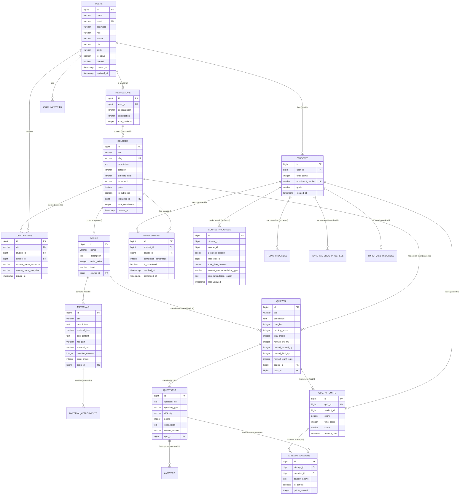

# LearnSphere Platform — Complete Database Design & Data Architecture

## 1. Database Overview & Technology Configuration

LearnSphere utilizes **Spring Data JPA (Hibernate)** with an **H2 Relational Database Engine** running in persistent local file mode (`./data/learnspheredb`) with `AUTO_SERVER=TRUE` enabled. The architecture is fully compatible with enterprise RDBMS engines (e.g., MySQL 8.0, PostgreSQL) via standard dialect switching.

### Database Configuration (`application.properties`):
```properties
spring.datasource.url=jdbc:h2:file:./data/learnspheredb;AUTO_SERVER=TRUE;DB_CLOSE_DELAY=-1
spring.datasource.driver-class-name=org.h2.Driver
spring.datasource.username=sa
spring.datasource.password=
spring.jpa.database-platform=org.hibernate.dialect.H2Dialect
spring.jpa.hibernate.ddl-auto=update
```

---

## 2. Entity Relationship Diagram (ERD)



---

## 3. Entity Dictionary & Schema Details

### 3.1 Identity & User Tables
1. **`users` (`User.java`)**:
   - `id` (BIGINT, PK, Auto-increment)
   - `name` (VARCHAR(100), NOT NULL)
   - `email` (VARCHAR(150), UNIQUE, NOT NULL)
   - `password` (VARCHAR(255), NOT NULL, BCrypt hashed)
   - `role` (VARCHAR(20), Enum: `STUDENT`, `INSTRUCTOR`, `ADMIN`)
   - `avatar`, `bio`, `phone`, `skills` (TEXT / VARCHAR)
   - `is_active` (BOOLEAN, default TRUE)
   - `verified` (BOOLEAN, default FALSE)
   - `created_at`, `updated_at` (TIMESTAMP)

2. **`students` (`Student.java`)**:
   - `id` (BIGINT, PK)
   - `user_id` (BIGINT, FK -> `users.id`, UNIQUE)
   - `total_points` (INTEGER, default 0) — Gamification points earned from quizzes
   - `enrollment_number` (VARCHAR, UNIQUE)
   - `grade` (VARCHAR)

3. **`instructors` (`Instructor.java`)**:
   - `id` (BIGINT, PK)
   - `user_id` (BIGINT, FK -> `users.id`, UNIQUE)
   - `specialization`, `qualification` (VARCHAR)
   - `total_students` (INTEGER, default 0)

---

### 3.2 Curriculum & Multi-Modal Content Tables
4. **`courses` (`Course.java`)**:
   - `id` (BIGINT, PK)
   - `title` (VARCHAR(255), NOT NULL)
   - `slug` (VARCHAR(255), UNIQUE)
   - `description` (TEXT)
   - `category` (VARCHAR(100))
   - `difficulty_level` (VARCHAR(20), Enum: `BEGINNER`, `INTERMEDIATE`, `ADVANCED`)
   - `instructor_id` (BIGINT, FK -> `instructors.id`)
   - `thumbnail` (VARCHAR(255))
   - `price` (DECIMAL(10,2))
   - `is_published` (BOOLEAN, default FALSE)
   - `total_enrollments` (INTEGER, default 0)

5. **`topics` (`Topic.java`)**:
   - `id` (BIGINT, PK)
   - `name` (VARCHAR(255), NOT NULL)
   - `description` (TEXT)
   - `order_index` (INTEGER)
   - `level` (VARCHAR(20), Enum: `BEGINNER`, `INTERMEDIATE`, `ADVANCED`)
   - `course_id` (BIGINT, FK -> `courses.id`)

6. **`materials` (`Material.java`)**:
   - `id` (BIGINT, PK)
   - `title` (VARCHAR(255), NOT NULL)
   - `description` (TEXT)
   - `material_type` (VARCHAR(20), Enum: `TEXT`, `PDF`, `VIDEO`, `IMAGE`, `LINK`)
   - `text_content` (LONGTEXT / TEXT)
   - `file_path` (VARCHAR(500))
   - `external_url` (VARCHAR(500))
   - `duration_minutes` (INTEGER)
   - `order_index` (INTEGER)
   - `topic_id` (BIGINT, FK -> `topics.id`)

---

### 3.3 Assessment & Evaluation Tables
7. **`quizzes` (`Quiz.java`)**:
   - `id` (BIGINT, PK)
   - `title` (VARCHAR(255), NOT NULL)
   - `description` (TEXT)
   - `time_limit` (INTEGER, minutes)
   - `passing_score` (INTEGER, default 50/60)
   - `total_marks` (INTEGER)
   - `reward_first_try` (INTEGER, default 50 points)
   - `reward_second_try` (INTEGER, default 30 points)
   - `reward_third_try` (INTEGER, default 15 points)
   - `reward_fourth_plus` (INTEGER, default 5 points)
   - `course_id` (BIGINT, FK -> `courses.id`, Nullable)
   - `topic_id` (BIGINT, FK -> `topics.id`, Nullable)

8. **`questions` (`Question.java`)**:
   - `id` (BIGINT, PK)
   - `question_text` (TEXT, NOT NULL)
   - `question_type` (VARCHAR(20), Enum: `MCQ`, `TRUE_FALSE`, `SHORT_ANSWER`, `LONG_ANSWER`)
   - `difficulty` (VARCHAR(20))
   - `points` (INTEGER, default 1)
   - `explanation` (TEXT)
   - `correct_answer` (VARCHAR(500))
   - `quiz_id` (BIGINT, FK -> `quizzes.id`)

9. **`answers` (`Answer.java`)**:
   - `id` (BIGINT, PK)
   - `answer_text` (TEXT)
   - `is_correct` (BOOLEAN)
   - `question_id` (BIGINT, FK -> `questions.id`)

10. **`quiz_attempts` (`QuizAttempt.java`)**:
    - `id` (BIGINT, PK)
    - `quiz_id` (BIGINT, FK -> `quizzes.id`)
    - `student_id` (BIGINT, student reference)
    - `score` (DOUBLE, percentage 0-100)
    - `time_spent` (INTEGER, seconds)
    - `status` (VARCHAR(20), `PASSED` / `FAILED` / `COMPLETED`)
    - `attempt_time` (TIMESTAMP)

11. **`attempt_answers` (`AttemptAnswer.java`)**:
    - `id` (BIGINT, PK)
    - `attempt_id` (BIGINT, FK -> `quiz_attempts.id`)
    - `question_id` (BIGINT, FK -> `questions.id`)
    - `student_answer` (TEXT)
    - `is_correct` (BOOLEAN)
    - `points_earned` (INTEGER)

---

### 3.4 Progress, Certificates & Telemetry Tables
12. **`enrollments` (`Enrollment.java`)**:
    - `id` (BIGINT, PK)
    - `student_id` (BIGINT, FK -> `students.id`)
    - `course_id` (BIGINT, FK -> `courses.id`)
    - `completion_percentage` (INTEGER, 0-100)
    - `is_completed` (BOOLEAN, default FALSE)
    - `enrolled_at` (TIMESTAMP)
    - `completed_at` (TIMESTAMP, Nullable)

13. **`course_progress` (`CourseProgress.java`)**:
    - `id` (BIGINT, PK)
    - `student_id` (BIGINT)
    - `course_id` (BIGINT)
    - `progress_percent` (DOUBLE)
    - `last_topic_id` (BIGINT)
    - `total_time_minutes` (DOUBLE)
    - `current_recommendation_type` (VARCHAR: `NEXT_TOPIC`, `REVISION`, `PRACTICE`)
    - `recommendation_reason` (TEXT)
    - `last_updated` (TIMESTAMP)

14. **`topic_material_progress` (`TopicMaterialProgress.java`)**:
    - `id` (BIGINT, PK)
    - `student_id` (BIGINT)
    - `topic_id` (BIGINT)
    - `material_id` (BIGINT)
    - `completed` (BOOLEAN)
    - `completed_at` (TIMESTAMP)

15. **`topic_quiz_progress` (`TopicQuizProgress.java`)**:
    - `id` (BIGINT, PK)
    - `student_id` (BIGINT)
    - `topic_id` (BIGINT)
    - `completed` (BOOLEAN)
    - `score` (DOUBLE)
    - `completed_at` (TIMESTAMP)

16. **`certificates` (`Certificate.java`)**:
    - `id` (BIGINT, PK)
    - `uid` (VARCHAR(100), UNIQUE, UUID format)
    - `student_id` (BIGINT, FK -> `users.id`)
    - `course_id` (BIGINT, FK -> `courses.id`)
    - `student_name_snapshot` (VARCHAR(150))
    - `course_name_snapshot` (VARCHAR(255))
    - `issued_at` (TIMESTAMP)

17. **`user_activities` (`UserActivity.java`)**:
    - `id` (BIGINT, PK)
    - `user_id` (BIGINT)
    - `date` (DATE)
    - `minutes_spent` (INTEGER)
