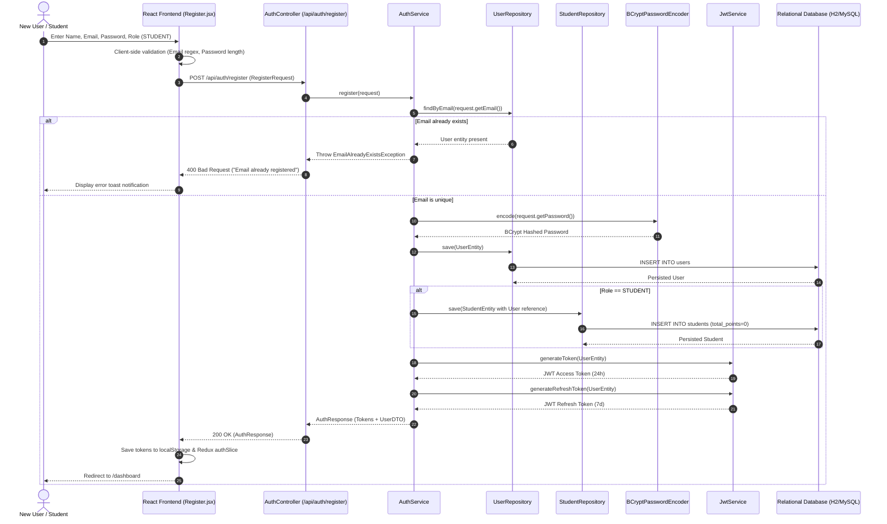
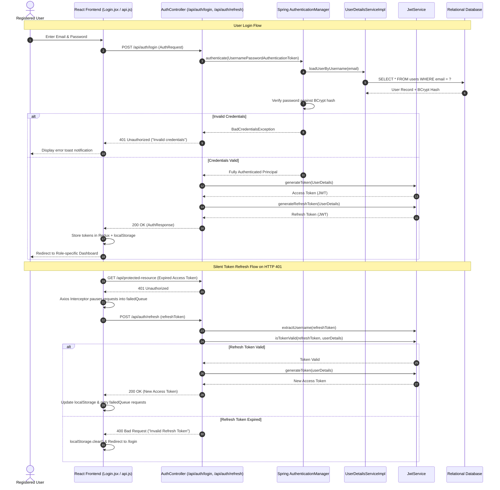
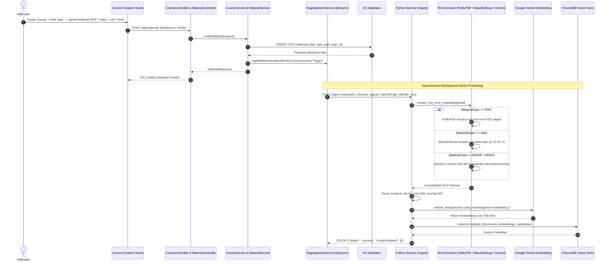
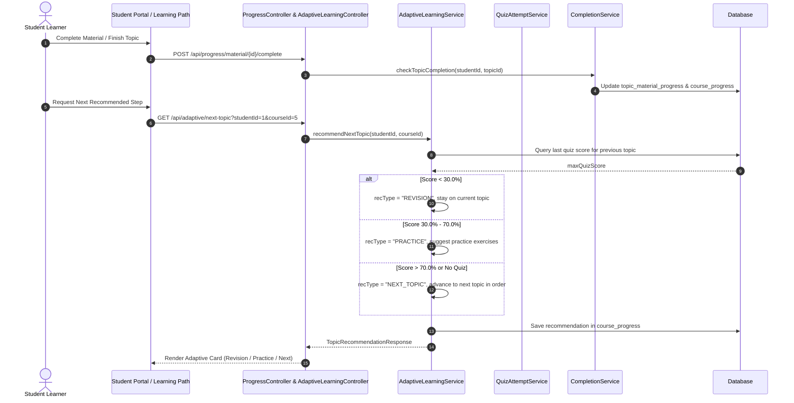
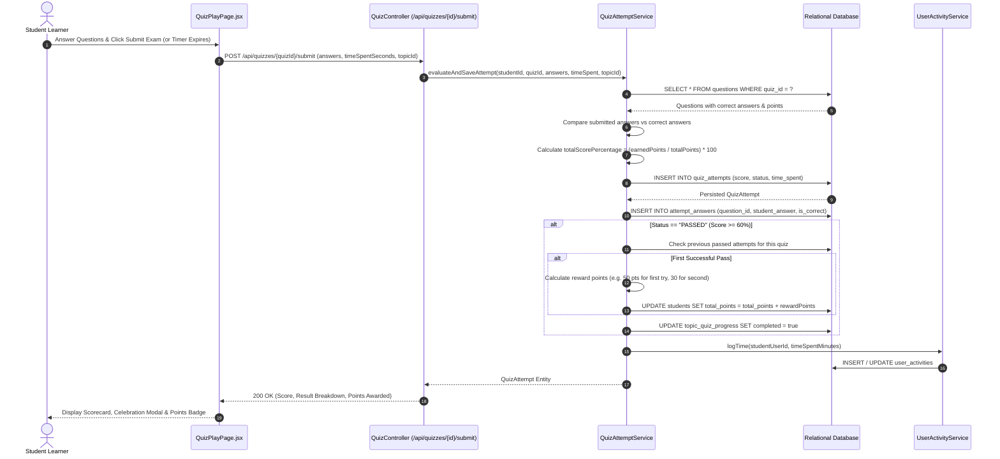
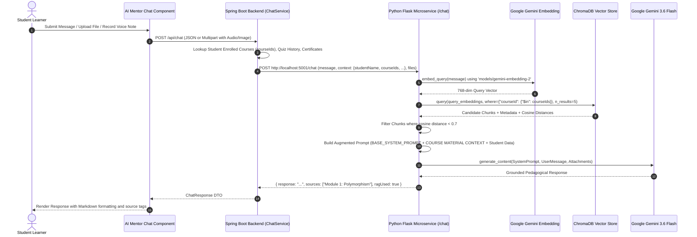
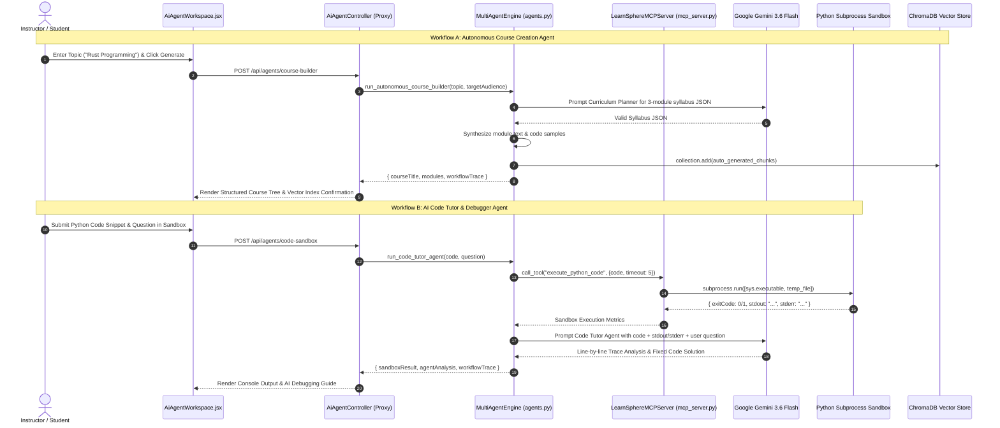

# LearnSphere Platform — Complete System Flow & Sequence Diagrams

---

## 1. User Registration Flow

---

## 2. User Login & Token Refresh Flow

---

## 3. Course Creation & Multi-Modal Material Ingestion Flow

---

## 4. Student Learning Journey & Adaptive Progression

---

## 5. Quiz Play, Submission, Scoring & Gamification Flow

---

## 6. Multi-Modal RAG Chat & Grounded Retrieval Flow

---

## 7. Multi-Agent Autonomous Course Builder & Code Debugger Flow

